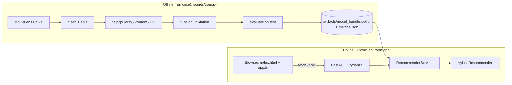

# MovieTalks — Personalized Movie Recommendation System

A hybrid recommender built on the [MovieLens](https://grouplens.org/datasets/movielens/) dataset. It combines a
**popularity baseline**, **content-based filtering (TF-IDF + cosine similarity)** and **collaborative filtering
(biased matrix factorization trained with ALS)**, with cold-start fallbacks, served by **FastAPI** to a responsive
**vanilla-JS** frontend.

No paid APIs, no API keys, no pre-made recommendation data: every recommendation comes from models trained on the
ratings you download.

> **Status of results.** This README only reports numbers that were produced by running the code. The real MovieLens
> evaluation table below is filled in by `scripts/update_readme.py` after *you* run training (see
> [Evaluation results](#evaluation-results)). See [Verification status](#verification-status) for exactly what has
> and has not been tested.

---

## Quick start using the college dataset (recommended for submission)

The ZIP includes `data/raw/dataset.csv`, the college-provided dataset, and a backend training script that creates the model artifact expected by the existing FastAPI app. On Windows PowerShell, from this project folder run:

```powershell
py -m venv .venv
.\.venv\Scripts\Activate.ps1
python -m pip install --upgrade pip
pip install -r requirements.txt
pip install -r requirements-dev.txt
python scripts\prepare_college_data.py
python scripts\eda_college_dataset.py
python scripts\evaluate_college_dataset.py
python scripts\train_college_api.py
python -m pytest -q
uvicorn api.main:app --reload
```

Open `http://127.0.0.1:8000` for the frontend, or `http://127.0.0.1:8000/docs` to try the API. Check `http://127.0.0.1:8000/api/health`; it should report `"status":"ok"`. The API training script uses the most frequent provided genre/year per title because the supplied dataset contains conflicting metadata; these values are not verified real-world movie facts. The dataset has only eight distinct titles, so recommendation quality is limited.

`python scripts\train_college_api.py` is the required training step before launching the API. The separate `scripts\train.py` workflow below is for MovieLens-format files and is not needed for the college-dataset demo.

---

## ML deliverable vs optional web app

The project title is *Personalised Movie Recommendation System Using Collaborative Filtering*, so the ML component
is the deliverable. The web app is optional and can be dropped without touching the ML.

| | Files | Needed for the ML deliverable? |
|---|---|---|
| **Essential (ML)** | `config.py`, `recsys/*` (except `service.py`), `scripts/download_data.py`, `scripts/eda.py`, `scripts/train.py`, `scripts/update_readme.py`, `tests/` (all except `test_api.py`), `requirements.txt` | Yes |
| **Useful extra** | `recsys/service.py`, `scripts/recommend.py` (command-line top-N, no server) | Convenient, not required |
| **Optional (web app)** | `api/`, `frontend/`, `tests/test_api.py`, `Dockerfile`, `render.yaml` | No. Delete or ignore freely |

ML-only workflow (Windows PowerShell, after installing, see [Setup](#setup-on-windows)):
```powershell
python scripts\download_data.py            # MovieLens ml-latest-small -> data\raw\
python scripts\train.py                    # clean, split, tune, evaluate, save -> artifacts\
python scripts\recommend.py --user 1 --n 10   # personalised top-10 for MovieLens user 1
python scripts\recommend.py --popular --n 10  # popularity baseline, for comparison
```
`artifacts\RESULTS.md` then contains the table that compares collaborative filtering (ALS matrix factorization)
with the popularity baselines on RMSE/MAE and Precision/Recall/NDCG@10, plus coverage and diversity.

### What is still needed once MovieLens is available
1. Get the data: `python scripts\download_data.py`, or download `ml-latest-small.zip` in a browser and run
   `python scripts\download_data.py --zip C:\path\to\ml-latest-small.zip`.
2. `python scripts\eda.py` (figures) and `python scripts\train.py` (full run with tuning, a few minutes).
3. Open `artifacts\RESULTS.md`; check that the top of the file has **no** "SYNTHETIC" banner and that
   `metrics.json -> meta.dataset` names `ml-latest-small`.
4. Read the comparison honestly: *rating-count popularity* is a strong baseline on MovieLens, so collaborative
   filtering may not win on every ranking metric. Report what the table shows, including a loss.
5. `python scripts\update_readme.py` copies the real tables into this README (it refuses synthetic results).
6. Optional: spot-check a few `recommend.py --user N` lists against that user's rated movies.

Until step 2 has been run on real data, **no real-data result exists** and none is claimed in this repository.

---

## Contents
1. [Features](#features) · 2. [Project structure](#project-structure) · 3. [Architecture and data flow](#architecture-and-data-flow)
4. [Module guide](#module-guide) · 5. [Algorithms](#algorithms) · 6. [Evaluation method and metrics](#evaluation-method-and-metrics)
7. [Design decisions](#design-decisions) · 8. [Setup on Windows](#setup-on-windows) · 9. [Running the app](#running-the-app)
10. [API reference](#api-reference) · 11. [Evaluation results](#evaluation-results) · 12. [Deployment](#deployment-guide)
13. [Limitations](#limitations) · 14. [Verification status](#verification-status) · 15. [Interview cheat-sheet](#interview-cheat-sheet)

---

## Features
- **Data pipeline**: cleaning (nulls, out-of-range ratings, unknown movies, duplicate ratings), title/year/genre parsing, EDA with figures.
- **Models**: popularity (Bayesian weighted rating), content-based (TF-IDF over genres, decade, tags), collaborative (ALS matrix factorization with damped biases), and a hybrid blend.
- **Cold-start handling**: new users (0 ratings → popularity, 1–4 → content + popularity, ≥5 → full hybrid) and new/rarely-rated movies (CF score missing → hybrid falls back to content + popularity).
- **Leakage-safe evaluation**: chronological per-user train/validation/test split, tuning only on validation, final metrics on test.
- **Metrics**: RMSE, MAE, Precision@K, Recall@K, NDCG@K, catalog coverage, intra-list diversity, novelty, plus a cold-start simulation.
- **Frontend**: movie search, cards with half-star rating, similar-movie view, personalized "For You" feed, genre preference chips, "My ratings" drawer, demo mode that replays an existing MovieLens user, evaluation dialog. Responsive, dark/light by system setting.
- **Engineering**: ML code separate from API code, Pydantic validation, error handlers, seeded/reproducible training, saved artifacts, training separate from app start-up, pytest suite.

## Project structure
```
movie-recommender/
├── README.md  requirements.txt  requirements-dev.txt  .gitignore  .dockerignore
├── config.py                  # all paths, seeds and hyperparameters in one place
├── recsys/                    # ML package (no web-framework imports)
│   ├── data.py                # load, clean, chronological per-user split, tag text
│   ├── popularity.py          # Bayesian weighted-rating baseline
│   ├── content.py             # TF-IDF + cosine similarity, user taste profile
│   ├── collaborative.py       # ALS matrix factorization, fold-in for new users
│   ├── hybrid.py              # rank-normalised blend + cold-start routing
│   ├── metrics.py             # RMSE/MAE, P/R/NDCG@K, coverage, novelty
│   ├── evaluate.py            # evaluation loops, CF + hybrid-weight tuning, cold-start simulation
│   ├── pipeline.py            # train → evaluate → refit → save artifacts
│   ├── eda.py                 # EDA statistics and figures
│   └── service.py             # loads artifacts, answers queries (used by the API)
├── api/
│   ├── main.py                # FastAPI app + endpoints + static frontend
│   └── schemas.py             # Pydantic request/response models (validation)
├── frontend/                  # index.html, style.css, app.js (no build step)
├── scripts/                   # download_data.py, eda.py, train.py, recommend.py (CLI), update_readme.py
├── tests/                     # pytest suite (+ synthetic fixture generator)
├── docs/figures/              # EDA figures (generated)
├── data/raw/                  # MovieLens CSVs (downloaded, git-ignored)
├── artifacts/                 # model_bundle.joblib, metrics.json, RESULTS.md (generated, git-ignored)
├── Dockerfile  render.yaml    # deployment templates (untested, see Deployment)
```

## Architecture and data flow


**From user input to recommendation output** (the "For You" feed):
1. The user rates movies on cards; `app.js` stores them in `localStorage` (the server keeps no user state).
2. `app.js` sends `POST /api/recommend` with `{ratings:[{movie_id, rating}], genres, n}`.
3. `api/schemas.py` validates it (rating 0.5–5 in half steps, no duplicate movies, ≤500 ratings, `n` ≤ 50, safe genre strings). Bad input → HTTP 422.
4. `RecommenderService.recommend` maps movie ids to catalog indices (unknown id → HTTP 404).
5. `HybridRecommender.route` picks a strategy by number of ratings: 0 → popularity, 1–4 → content + popularity, ≥5 → CF + content + popularity.
6. For the CF part the user is "folded in": with the item factors frozen, one small ridge regression estimates this user's bias and taste vector, then every movie is scored.
7. Each model's scores are converted to percentile ranks over the candidate movies (excluding already-rated ones, optionally restricted to the chosen genres) and blended with the validated weights.
8. Top-n movies come back with a human-readable reason ("Because you liked …"), CF predicted rating, and IMDb link; the frontend renders cards.

## Module guide
| Module | Purpose |
|---|---|
| `config.py` | Single source of truth for paths, seed, split fractions, hyperparameters. |
| `recsys/data.py` | Parses MovieLens, cleans rows, builds the chronological split, builds tag text restricted to visible interactions. |
| `recsys/popularity.py` | Baseline ranking and cold-start fallback. |
| `recsys/content.py` | TF-IDF item vectors; item-to-item similarity; user taste profile; intra-list diversity. |
| `recsys/collaborative.py` | ALS matrix factorization, prediction, fold-in of new users, latent item similarity. |
| `recsys/hybrid.py` | Combines the three models, routes cold-start cases, explains each recommendation. |
| `recsys/metrics.py` | Hand-written metric functions (unit-tested against hand-computed values). |
| `recsys/evaluate.py` | Runs the evaluation, tunes CF hyperparameters and hybrid weights on validation, simulates cold-start users. |
| `recsys/pipeline.py` | The training orchestration and artifact writing. |
| `recsys/service.py` | The only thing the API talks to; no FastAPI code in here. |
| `api/main.py`, `api/schemas.py` | HTTP layer: routing, validation, error handling, CORS, serving the frontend. |

## Algorithms
**Popularity (baseline).** `score = v/(v+m)·R + m/(v+m)·C` where `R` is the movie's mean rating, `v` its rating count, `C` the global mean and `m` the 60th-percentile rating count. A plain average would rank a movie with a single 5★ rating first; shrinking toward `C` fixes that, and unrated movies score exactly `C`.

**Content-based filtering.** Each movie becomes a text document: genre tokens (×2), a decade token (`decade1990`), and user-applied tags. `TfidfVectorizer` turns documents into L2-normalised vectors, so the dot product of two movies *is* their cosine similarity. A user's taste profile is `Σ (rating − user_mean) · tfidf(movie)`; movies are scored by cosine to that profile. Mean-centering means disliked movies push the profile away. The full 9k×9k similarity matrix is never built; one row is computed on demand.

**Collaborative filtering (matrix factorization with ALS).** `r̂(u,i) = μ + b_i + b_u + p_u·q_i`. Biases are damped (`Σresidual / (n + λ)`) so items/users with few ratings are not over-trusted. The residuals are factorised by Alternating Least Squares: with item factors fixed, each user's vector is a small closed-form ridge regression, then vice versa, for 12 sweeps. I chose ALS over `sklearn.TruncatedSVD` because plain SVD treats unobserved ratings as zeros; ALS fits only observed ratings, which is what "SVD" meant in the Netflix Prize. A brand-new user is handled by **fold-in**: solve the same ridge problem for just that user with item factors frozen, so no retraining is needed.

**Hybrid.** The three models score on different scales, so each is converted to percentile ranks over the candidates and blended: `final(i) = Σ w_m·rank_m(i) / Σ w_m` over models that actually scored movie `i`. If a movie has fewer than 3 training ratings the CF score is *missing* and the denominator simply drops CF, which is the item cold-start fallback. Weights `(w_cf, w_content, w_pop)` are chosen by grid search (step 0.1) maximising NDCG@10 on the **validation** split.

**Similar movies.** 50/50 blend of content cosine and cosine between CF latent item vectors (content only if the movie has too few ratings). These weights are a fixed default, not tuned.

## Evaluation method and metrics
**Split (no leakage).** Per user, ratings are sorted by time: oldest ~70% train, next ~10% validation, newest ~20% test (users with <5 ratings stay in train). Then:
- **Stage A** fit on train → tune CF hyperparameters (validation RMSE) and hybrid weights (validation NDCG@10).
- **Stage B** fit on train+validation → report *test* metrics. Test data is never used for any choice.
- **Stage C** fit on all ratings → the model that is saved and served.
- Candidate lists exclude movies already in a user's visible history; tags are only used from (user, movie) pairs the model is allowed to see.

| Metric | Meaning |
|---|---|
| RMSE / MAE | Error of predicted star ratings on held-out ratings (lower is better). RMSE punishes large misses more. Reported for ablations: global mean → item bias → user+item bias → full MF. |
| Precision@K | Fraction of the K recommended movies that the user later rated ≥ 4★. |
| Recall@K | Fraction of the user's relevant held-out movies that appear in the top K. |
| NDCG@K | Like precision but rewards hits near the top (`1/log2(rank+1)`), normalised by the best possible ordering. Our primary ranking metric. |
| Coverage@K | Distinct movies ever recommended ÷ catalog size. Low = same few movies for everyone. |
| Diversity@K | Mean (1 − cosine) between content vectors of the movies inside one list. |
| Novelty@K | Mean −log2(popularity) of recommended movies; higher = less obvious picks. |

Ranking baselines included for honesty: **random**, **popularity (weighted rating)** and **popularity (raw rating count)**. The count baseline is often hard to beat on offline MovieLens metrics because popular movies are more likely to appear in any user's test set. Always compare against it.

A **cold-start simulation** reveals only each test user's first *m* ratings (m = 0, 1, 3, 5, 10, 20) and measures NDCG@10 for popularity, content-only, CF-only and the hybrid.

## Design decisions
| Decision | Why |
|---|---|
| Chronological per-user split instead of random | Random splits let the model train on a user's future ratings. |
| ALS instead of `TruncatedSVD` | Fits only observed ratings; supports exact fold-in for new users. |
| Percentile-rank blending | Models have incomparable score scales; ranks make the blend scale-free. |
| Sparse on-demand similarity | A dense 9k×9k float matrix is ~300 MB; free hosting tiers have ~512 MB. |
| Stateless API; ratings in `localStorage` | No database or login needed; the server only does math. |
| Training separate from API start-up | Start-up only loads `model_bundle.joblib`; training is `scripts/train.py` (and the *build* step when deploying). |
| ML code has no FastAPI imports | `recsys/` can be tested and reused without a server. |
| Gradient "posters" | Real posters need a third-party API/key; the brief required none. |
| All hyperparameters in `config.py`, fixed seed | Same data + same seed → same model (checked by a test). |

## Setup on Windows
Requires **Python 3.10+** (tested on 3.13), Git, and VS Code. Commands are for **PowerShell** in the project folder.

```powershell
# 1. open the project
cd path\to\movie-recommender
code .

# 2. create and activate a virtual environment
py -3 -m venv .venv
.venv\Scripts\Activate.ps1
#   if PowerShell blocks the script:  Set-ExecutionPolicy -Scope Process -ExecutionPolicy Bypass
#   Command Prompt instead:           .venv\Scripts\activate.bat

# 3. install dependencies
python -m pip install --upgrade pip
pip install -r requirements.txt

# 4. download MovieLens (ml-latest-small, ~1 MB) into data\raw\
python scripts\download_data.py
#   offline / blocked?  download the zip in a browser, then:
#   python scripts\download_data.py --zip C:\path\to\ml-latest-small.zip

# 5. exploratory analysis -> docs\figures\*.png and eda_summary.json
python scripts\eda.py

# 6. train + evaluate + save artifacts -> artifacts\model_bundle.joblib, metrics.json, RESULTS.md
python scripts\train.py
#   faster, skips the CF hyperparameter search:  python scripts\train.py --no-tune

# 7. (optional) copy the measured tables from artifacts\RESULTS.md into this README
python scripts\update_readme.py
```

## Running the app
```powershell
uvicorn api.main:app --reload
```
Open **http://127.0.0.1:8000** (the same server serves the frontend). Interactive API docs: http://127.0.0.1:8000/docs.

Frontend on its own port (optional; the page automatically calls the API on port 8000, CORS is enabled):
```powershell
# terminal 1
uvicorn api.main:app --reload
# terminal 2
cd frontend
python -m http.server 5500      # then open http://localhost:5500
```
Run the tests (use a synthetic fixture, no download needed):
```powershell
pip install -r requirements-dev.txt
pytest -q
```
If you start the server before training, the page shows a banner and `/api/health` reports `no_model`; run step 6 and restart.

Push to GitHub:
```powershell
git init
git add .
git commit -m "Hybrid movie recommender with FastAPI frontend"
git branch -M main
git remote add origin https://github.com/<your-username>/movie-recommender.git
git push -u origin main
```
`data/raw` and `artifacts` are git-ignored (MovieLens terms disallow redistributing the data). To show EDA figures on GitHub, commit `docs/figures`.

## API reference
| Method & path | Purpose |
|---|---|
| `GET /api/health` | Liveness; `status: ok` or `no_model`. |
| `GET /api/genres` | Genre names. |
| `GET /api/movies/search?q=&limit=&genre=` | Title search (all words must match; prefix matches and popular movies first). |
| `GET /api/movies/{id}` | One movie. |
| `GET /api/movies/{id}/similar?n=&genres=` | Item-to-item recommendations. |
| `GET /api/popular?n=&genres=` | Top movies by weighted rating (cold start). |
| `POST /api/recommend` | Personalised recommendations from a list of ratings (routing described above). |
| `GET /api/users/{id}/recommend?n=&genres=` | Recommendations for an existing MovieLens user (demo). |
| `GET /api/metrics` | The `metrics.json` produced by training. |

Errors: `422` invalid input (bad rating, duplicate movie, unknown genre, empty query), `404` unknown movie/user, `503` model not trained, `500` unexpected (details are logged, not leaked).

## Evaluation results
<!-- RESULTS:START -->
_Not generated yet._ Run `python scripts\train.py` and then `python scripts\update_readme.py` to insert the measured
RMSE/MAE, Precision/Recall/NDCG@K, coverage, diversity, novelty and cold-start tables here.
<!-- RESULTS:END -->

How to read them: compare **hybrid** against both popularity baselines on NDCG@10 and Recall@10, and look at coverage/diversity to see whether accuracy was bought with a narrow catalog. The cold-start table shows whether the routing thresholds (`MIN_RATINGS_FOR_CF`, `COLD_START_WEIGHTS` in `config.py`) are sensible; if CF-only beats the cold-start blend at small *m*, lower `MIN_RATINGS_FOR_CF`. Do not quote a number you have not seen in your own `metrics.json`.

## Deployment guide
Training happens at **build** time; the web process only loads artifacts. Both templates below are **untested** (no Docker or hosting access in the build environment). Check each provider's current free-tier limits; free web services typically sleep when idle, so the first request after a pause can be slow.

**Render (no Docker).** Push to GitHub → Render dashboard → *New → Blueprint* → select the repo. `render.yaml` sets:
- Build: `pip install -r requirements.txt && python scripts/download_data.py && python scripts/train.py --no-tune`
- Start: `uvicorn api.main:app --host 0.0.0.0 --port $PORT`, health check `/api/health`.

**Docker (Fly.io, Railway, Hugging Face Docker Spaces, …).** `docker build -t movietalks .` then `docker run -p 7860:7860 movietalks`. The image downloads data and trains during `docker build`.

Memory sanity check: with a *synthetic* dataset of MovieLens-small size, the API process used ≈181 MB resident, comfortably inside a 512 MB tier.

Optional hardening for a public deployment: set `CORS_ORIGINS` to your site's origin (default is `*`), add rate limiting (e.g. `slowapi`) in front of `/api/recommend`.

## Limitations
- **Per-user, not global, time split.** Models trained on "past" ratings of one user still see other users' later ratings. This is standard but slightly optimistic compared with a strict global-time split.
- **Offline ≠ online quality.** MovieLens only has ratings for movies users chose to watch; metrics measure agreement with past behaviour, not true satisfaction.
- **Scale.** Built and checked for `ml-latest-small` (~100k ratings). ALS uses a Python loop over users/items, so much larger datasets (millions of ratings) would need a vectorised/parallel implementation. Only the `ml-latest*` CSV format is supported (not `ml-1m`/`ml-10m` `.dat` files).
- **Untuned defaults:** cold-start weights, similar-movie blend, and the 3-rating CF support threshold are fixed defaults; the cold-start table lets you judge them.
- **No accounts or server-side storage:** ratings live in the browser's `localStorage`. No authentication or rate limiting is included.
- **Posters** are generated gradients, not real artwork.

## Verification status
Checked in the build environment (Python 3.13, versions in `requirements.txt` comments):
- ✅ `pytest`: **145 tests pass** (run `python -m pytest -q`): data cleaning and splits, leakage guards, hand-computed metrics, ML unit tests, dataset-independence checks (swapping data/scale, refusing synthetic results), the command-line recommender, and the API (97 tests). They run on a **synthetic fixture**, which verifies behaviour, not recommendation quality. Also run with pandas 2.3.3 and 3.0.5.
- ✅ `scripts/train.py` then `scripts/recommend.py` run end to end on a synthetic dataset (Linux).
- ✅ Full pipeline (`train.py`), `eda.py` and `download_data.py --zip` run end to end on synthetic data; download failure prints a helpful message.
- ✅ Frontend wiring checked against the live API in a headless DOM (jsdom): 21 checks covering load, rating (incl. half-stars), refresh to hybrid, genre filter, search → similar, tabs, demo user, error handling, drawer, clear ratings.
- ✅ Scale/performance check on synthetic data of MovieLens-small *size* (610 users, 9,700 movies, ~103k ratings): training with tuning took ~152 s and peaked at ~212 MB; each API endpoint answered in <10 ms median locally.

**Not verified:**
- ❌ **Any result on real MovieLens data.** The build environment could not reach `files.grouplens.org`. No real metric is claimed anywhere; generate them with the commands above.
- ❌ Visual layout and responsiveness in real browsers/phones, and cross-browser behaviour. The frontend has only been checked in a simulated DOM (jsdom); no real-browser test was run.
- ❌ Whether collaborative filtering beats the popularity baselines on real data. On the synthetic fixture the rating-count popularity baseline scored higher than MF on top-10 ranking; that says nothing about MovieLens.
- ❌ Windows-specific execution (commands are standard but were run on Linux), Python 3.10–3.12, and the Render/Docker templates.

## Interview cheat-sheet
- **Why hybrid?** Popularity solves new users, content solves new movies, CF captures taste patterns that metadata can't. The blend routes by how much we know.
- **How do you stop leakage?** Chronological per-user split; tuning only on validation; tags limited to visible interactions; seen movies excluded from candidates; final metrics only from the test slice.
- **Why NDCG?** Users see a ranked list; NDCG rewards putting relevant movies first and handles multiple relevant items.
- **How do you recommend for someone with 3 ratings?** Content profile + popularity; CF needs ≥5 ratings, then fold-in solves a ridge regression for their taste vector with item factors frozen.
- **How is a brand-new movie handled?** It has no CF score; the blend divides only by the weights of models that scored it (content + popularity).
- **What would you improve?** Global-time split, implicit-feedback model (e.g. iALS/BPR), real-time feedback, vectorised/parallel ALS for larger data, A/B testing instead of offline metrics only.

## Data citation and license
Harper, F. M. & Konstan, J. A. (2015). *The MovieLens Datasets: History and Context.* ACM TiiS 5(4), Article 19. MovieLens data is for non-commercial use under GroupLens' terms; do not redistribute it with this repository.

---

## College dataset quick workflow

The college-provided dataset is stored at `data/raw/dataset.csv`. Its original seven columns are preserved; preprocessing adds a stable numeric `movie_id` in the cleaned output. The original source file is not overwritten.

Run these commands from the project root after installing `requirements.txt`:

```bash
python scripts/prepare_college_data.py
python scripts/eda_college_dataset.py
python scripts/evaluate_college_dataset.py
python -m pytest -q
```

Outputs:

- Cleaned data: `data/processed/dataset.csv`
- Column definitions: `data_dictionary.csv`
- Cleaning report: `docs/cleaning_report.json`
- EDA charts: `docs/figures/college_eda/`
- Evaluation results: `docs/evaluation_results.json` and `docs/evaluation_results.csv`
- Report outline: `docs/PROJECT_REPORT_OUTLINE.md`
- Ethics template: `docs/ETHICAL_COMPLIANCE_DECLARATION_TEMPLATE.md`
- Demo guide: `docs/DEMO_GUIDE.md`

**Dataset limitation:** the supplied file has only eight distinct movie titles, and genre/language/release-year values vary across rows for the same title. The evaluation results are illustrative only and do not establish production-quality recommendation performance. Review these limitations in the report rather than hiding them.
